<div align="center">

<h1>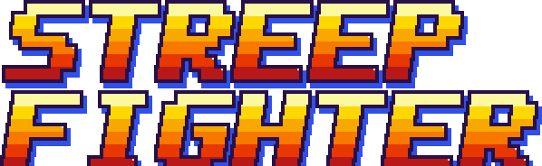</h1>

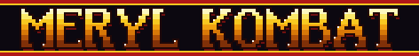

A 16-bit-style arcade fighting game starring six iconic Meryl Streep characters.
Built with Godot 4.6 and C#.

---


</div>

---

## 🎬 About

**Streep Fighter** is a love letter to both classic 90s arcade fighters and the greatest actress of all time. Pick your favorite Meryl, choose a stage inspired by her filmography, and duke it out in best-of-3 rounds.

Features PvP local multiplayer and a VS CPU mode with AI opponent.

It looks and plays like the SNES-era Street Fighter II it parodies: chunky 384×216 pixel art, frame-by-frame
sprite animation, scrolling parallax stages, and frame-data combat with crouching and jumping attacks,
high/low blocking, knockdowns and hit-stop.

<div align="center">

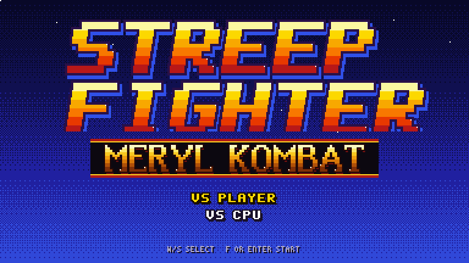 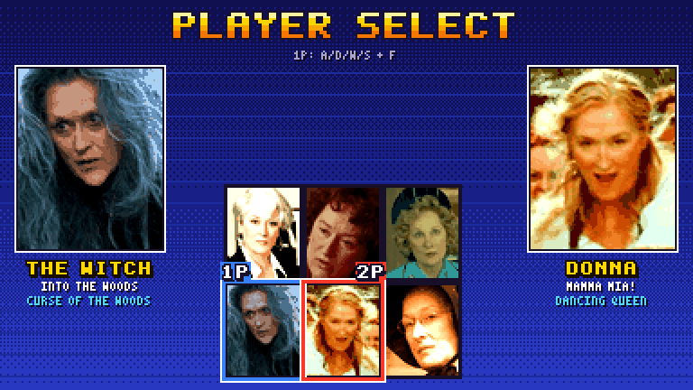

</div>

---

## 🎭 The Roster

Six playable fighters, each with unique stats and a signature special move.

<table>
<tr>
<td align="center" width="33%">
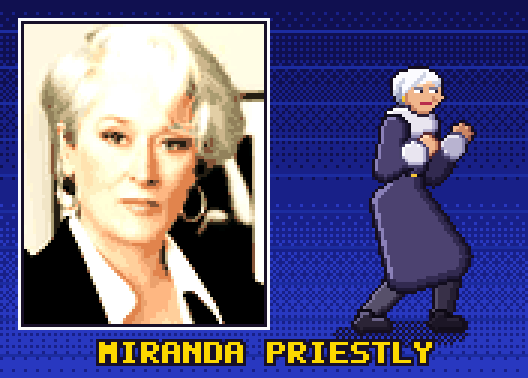<br/>
<b>Miranda Priestly</b><br/>
<i>The Devil Wears Prada (2006)</i><br/><br/>
<b>Special:</b> "That's All" — Lightning dash-slap<br/>
<b>Type:</b> ⚡ Speedster<br/>
<code>HP 1000 · SPD 105 · DMG 150</code>
</td>
<td align="center" width="33%">
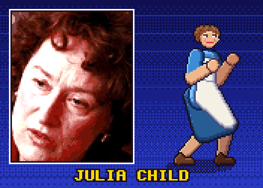<br/>
<b>Julia Child</b><br/>
<i>Julie & Julia (2009)</i><br/><br/>
<b>Special:</b> "Bon Appétit" — Throws a pot projectile<br/>
<b>Type:</b> 🍳 Zoner<br/>
<code>HP 1000 · SPD 84 · DMG 180</code>
</td>
<td align="center" width="33%">
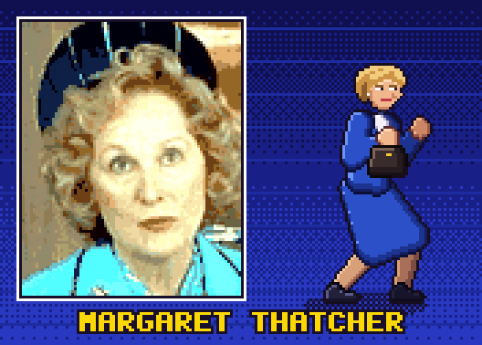<br/>
<b>Margaret Thatcher</b><br/>
<i>The Iron Lady (2011)</i><br/><br/>
<b>Special:</b> "Iron Fist" — Armored power punch<br/>
<b>Type:</b> 🛡️ Tank<br/>
<code>HP 1200 · SPD 76 · DMG 250</code>
</td>
</tr>
<tr>
<td align="center">
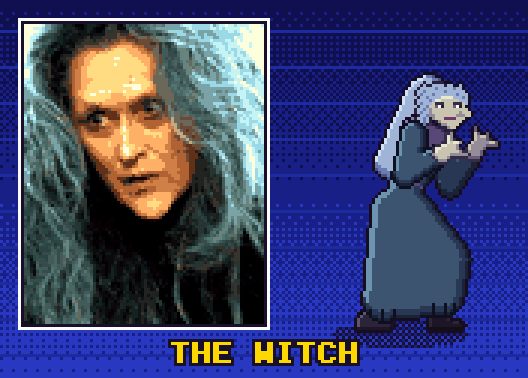<br/>
<b>The Witch</b><br/>
<i>Into the Woods (2014)</i><br/><br/>
<b>Special:</b> "Curse of the Woods" — Curse projectile<br/>
<b>Type:</b> 🔮 Glass Cannon<br/>
<code>HP 900 · SPD 92 · DMG 200</code>
</td>
<td align="center">
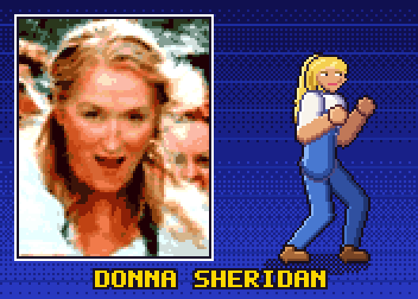<br/>
<b>Donna Sheridan</b><br/>
<i>Mamma Mia! (2008)</i><br/><br/>
<b>Special:</b> "Dancing Queen" — Double spin attack<br/>
<b>Type:</b> 💃 Combo Fighter<br/>
<code>HP 950 · SPD 118 · DMG 130</code>
</td>
<td align="center">
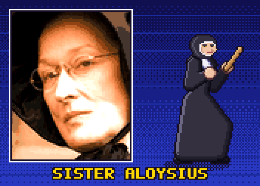<br/>
<b>Sister Aloysius</b><br/>
<i>Doubt (2008)</i><br/><br/>
<b>Special:</b> "Divine Discipline" — Lunging knockback strike<br/>
<b>Type:</b> ✝️ Bruiser<br/>
<code>HP 1100 · SPD 84 · DMG 180</code>
</td>
</tr>
</table>

---

## 🗺️ Stages

Six arenas, one per film, each the home turf of its fighter. Every stage is wider than the screen and scrolls
as the fight moves, with the distant scenery drifting behind at half speed, so there is more to find than
fits in one shot.

<table>
<tr>
<td align="center" width="50%" valign="top">
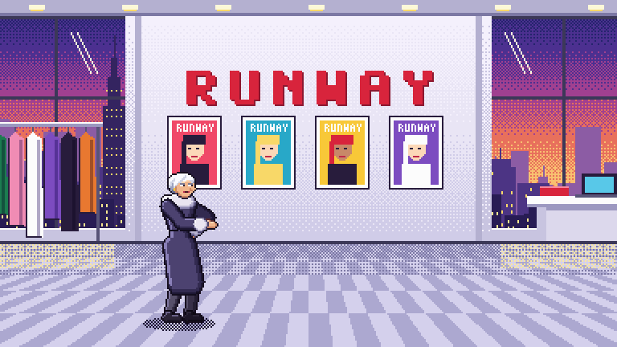<br/>
<b>Runway Magazine</b><br/>
<i>The Devil Wears Prada</i> · New York City<br/>
Home of Miranda Priestly<br/><br/>
Dusk over Manhattan through floor-to-ceiling glass, a wall of <i>Runway</i> covers, a rack of this season's samples and the Book waiting on Miranda's desk.
</td>
<td align="center" width="50%" valign="top">
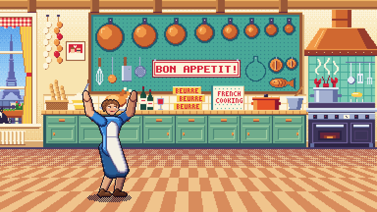<br/>
<b>Julia's Kitchen</b><br/>
<i>Julie &amp; Julia</i> · Paris, France<br/>
Home of Julia Child<br/><br/>
The pegboard of copper pans, a lobster in the stockpot, three bricks of <i>beurre</i> and the Eiffel Tower out the window. Scroll right and Paul is on the balcony, raising a glass.
</td>
</tr>
<tr>
<td align="center" width="50%" valign="top">
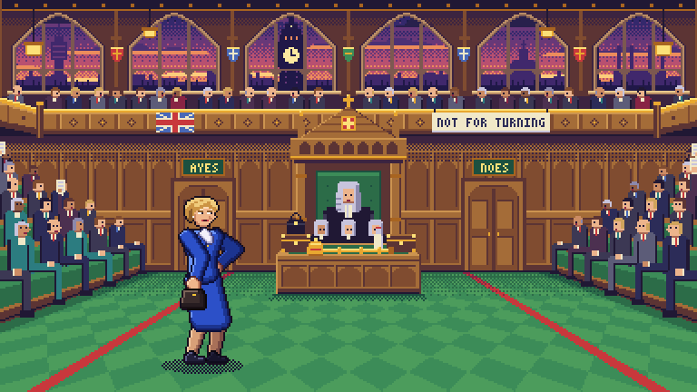<br/>
<b>House of Commons</b><br/>
<i>The Iron Lady</i> · London, England<br/>
Home of Margaret Thatcher<br/><br/>
Packed benches of jeering MPs, the Speaker under his canopy, the mace on the Table and Big Ben through the windows. There is a handbag on the despatch box.
</td>
<td align="center" width="50%" valign="top">
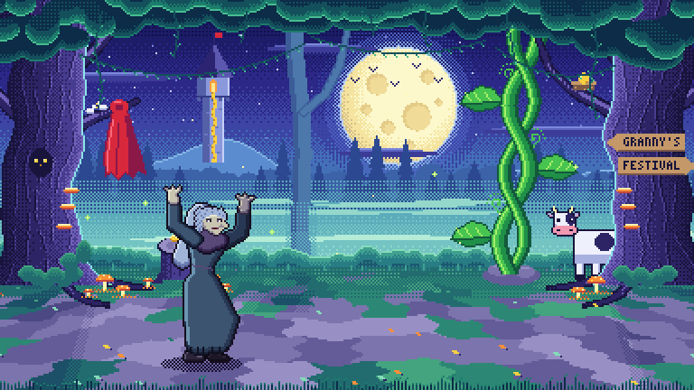<br/>
<b>Enchanted Woods</b><br/>
<i>Into the Woods</i> · Once upon a time<br/>
Home of The Witch<br/><br/>
A full moon, Rapunzel's tower with its rope of golden hair, a beanstalk, Milky White, a snagged red cape and a golden slipper on a stump. Something in the bushes has yellow eyes.
</td>
</tr>
<tr>
<td align="center" width="50%" valign="top">
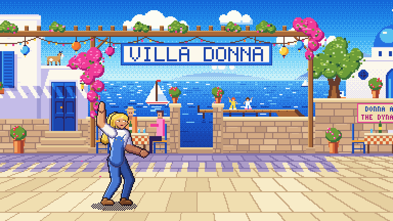<br/>
<b>Kalokairi Island</b><br/>
<i>Mamma Mia!</i> · Greece<br/>
Home of Donna Sheridan<br/><br/>
Villa Donna's terrace above the Aegean: bougainvillea, a goat on the roof, three possible dads sharing a table and the Dynamos mid-routine down on the jetty.
</td>
<td align="center" width="50%" valign="top">
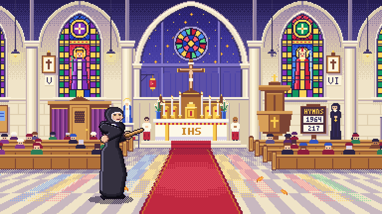<br/>
<b>St. Nicholas Church</b><br/>
<i>Doubt</i> · The Bronx, New York<br/>
Home of Sister Aloysius<br/><br/>
Stained-glass saints that drift behind the arches as you move, altar boys either side of the altar, bingo on Friday at 7 — and one blown light bulb.
</td>
</tr>
</table>

---

## 🕹️ Controls

### Player 1 (Keyboard Left)

| Key       | Action            |
| --------- | ----------------- |
| `A` / `D` | Move Left / Right |
| `W`       | Jump              |
| `S`       | Crouch            |
| `F`       | Punch             |
| `G`       | Kick              |
| `H`       | Block             |
| `T`       | Special Move      |

### Player 2 (Keyboard Right)

| Key       | Action            |
| --------- | ----------------- |
| `←` / `→` | Move Left / Right |
| `↑`       | Jump              |
| `↓`       | Crouch            |
| `Num1`    | Punch             |
| `Num2`    | Kick              |
| `Num3`    | Block             |
| `Num0`    | Special Move      |

### Moves

| Input                         | Move                                             |
| ----------------------------- | ------------------------------------------------ |
| Punch / Kick                  | Standing straight / high kick                    |
| Crouch + Punch / Kick         | Low jab / sweep (knocks down, must be blocked low) |
| Jump, then Punch / Kick       | Jump-in attack (must be blocked standing)        |
| Jump + Left / Right           | Committed forward or backward jump               |
| Hold **away** from an attack  | Block (crouch to block low). The Block key works too |
| Special                       | Signature move, on a cooldown shown under your name |

Menus: `W`/`S` or the arrow keys to move, `F` / `Enter` to confirm, `Esc` to pause.

---

## 🏗️ Project Structure

```
streep-fighter/
├── Assets/
│   ├── Portraits/             # Source film stills (digitised into UI portraits)
│   ├── Sprites/Fighters/      # Generated sprite sheets (44 frames each, + P2 colours)
│   ├── Sprites/FX/            # Generated hit sparks, dust, projectiles, shadow
│   ├── Stages/                # Generated stage layers + thumbnails
│   ├── UI/                    # Generated logo, portraits, announcer art
│   └── Fonts/                 # Generated bitmap fonts
├── Scenes/                    # Thin scenes; the scripts build their own nodes
├── Scripts/
│   ├── AI/                    # CPU opponent controller
│   ├── Fighters/              # Fighter simulation, frame data, special moves, stats
│   ├── Managers/              # GameManager, GameState, StageData
│   └── UI/                    # HUD, menus and screens (built in code at 384x216)
├── Tools/art/                 # The pixel-art generator (Python + Pillow)
├── docs/                      # README images: logo, screenshots, roster + stage cards (`build.py docs`)
├── screenshot_tool.tscn       # Dev tool: scripted playthrough that saves screenshots
├── project.godot
└── StreepFighter.csproj
```

---

## ⚔️ Game Mechanics

- **Best of 3 rounds** — First to 2 round wins takes the match
- **99-second timer** — If time runs out, the fighter with more HP% wins the round
- **Blocking** — Hold away from an attack; reduces damage (varies per fighter, 70%–92%)
- **High / low** — Sweeps must be blocked crouching, jump-ins standing
- **Special moves** — Unique per fighter, with cooldowns ranging from 3–5 seconds
- **Knockdowns** — Sweeps, specials and anything that hits you out of the air put you on the floor
- **Frame data** — Everything runs on a fixed 60Hz tick with startup / active / recovery frames, hit-stop and an input buffer, like the 16-bit originals

---

## 🎨 Art Pipeline

The game renders at **384×216** (the original Street Fighter II arcade width) and is scaled up with
nearest-neighbour filtering. All of the art is generated by the scripts in `Tools/art/`:

- `rig.py` / `anims.py` — a 2D skeleton and the pose library (every animation frame as IK targets)
- `fighters.py` — each fighter's costume and hand-pixelled head
- `stage_*.py` — one script per stage backdrop
- `ui.py`, `fx.py`, `font.py` — logo, portraits, effects and bitmap fonts

To regenerate everything after changing a pose, a costume or a stage (needs Python 3 + Pillow):

```bash
python3 Tools/art/build.py
```

Pass `fighters`, `stages`, `ui`, `fx` or `fonts` to rebuild just one group. Open the project in the Godot
editor afterwards (or run `godot --headless --import`) so it re-imports the changed images.

To check the result without playing through by hand, `screenshot_tool.tscn` drives the real menus and a
fight with synthetic key presses and saves native-resolution screenshots:

```bash
godot --path . res://screenshot_tool.tscn -- <out_dir> [fighter 0-5] [stage 0-5] [cpu|pvp]
```

---

## 🚀 Getting Started

### Requirements

- [Godot 4.6](https://godotengine.org/) with .NET support
- [.NET 8.0 SDK](https://dotnet.microsoft.com/download)

### Running

1. Clone the repo
2. Open `project.godot` in Godot 4.6 (.NET edition)
3. Build the C# solution (`dotnet build` or via Godot editor)
4. Hit Play (F5)

---

<div align="center">

_"I don't know why I'm so scary. I don't want to be."_

— Meryl Streep, before selecting Margaret Thatcher and landing a 250-damage Iron Fist

---

Made with 🎬 and 👊 in Godot 4.6

</div>
